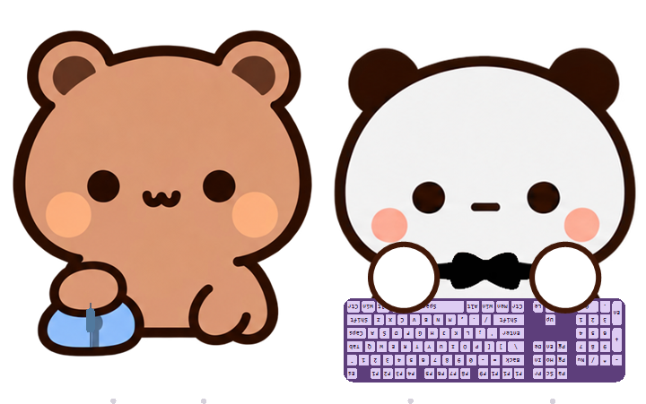
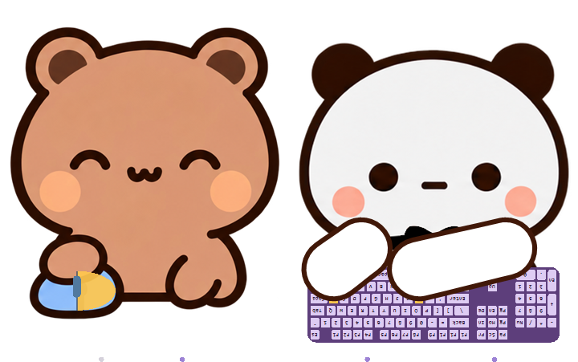

> **项目来源与致谢：本项目引用并参考了 [ayangweb/BongoCat](https://github.com/ayangweb/BongoCat) 的桌面宠物交互设计，并使用「一二布布」表情包作为角色形象参考。** 感谢 ayangweb 与 BongoCat 的贡献者，把日常敲键盘、点鼠标变成了有趣而温暖的桌面互动；也感谢[黄小B](https://weibo.com/u/2623471650)创造了一二和布布，用简洁的线条、细腻的表情和可爱的日常，为这么多人带来陪伴与快乐。特别感谢抖音用户「李达康」（抖音号：67810150099）：正是在观看他的视频后，才萌生了制作这个桌宠的想法。感谢他带来的灵感，让这个小项目有了起点。

# 一二布布桌宠 · YierBubu DesktopPet

让一二陪你打字，让布布陪你点鼠标。

一个 Windows 桌面宠物：布布坐在左边，单手操作鼠标；一二坐在右边，用圆圆的小手响应你的键盘。透明背景、置顶显示，工作、学习或聊天时，都能看到它们跟着输入做出小动作。



## 与 BongoCat 的关系

本项目的起点是对 [BongoCat](https://github.com/ayangweb/BongoCat) 的学习与参考，尤其是“让桌面角色响应真实键鼠输入”的互动思路。感谢原项目作者与开源社区的分享，也欢迎先去原项目看看，为喜欢的作品点一颗 Star。

当前发布的程序采用独立的 **C# / Win32 / GDI+** 实现，使用 PNG 分层素材和运行时绘制的键盘、手臂；没有接入 BongoCat 的 Rust / Live2D 主工程。它是一次面向一二布布形象的桌宠尝试，不是 BongoCat 官方版本，也不是其官方模型包。

角色形象参考一二布布表情包，部分桌宠 PNG 姿势通过 AI 图像工具辅助制作，再结合独立绘制的手部与输入反馈完成。角色及原表情包的权利仍归原作者与相应权利人，具体说明见 [来源与权利说明](CREDITS.md)。

## 可以做什么

- **一二响应键盘**：支持标准 104 键 ANSI/QWERTY 布局。1.0.1 会点亮具体按键，并让对应的小手平滑伸到该键的位置，松开后返回待机。
- **组合键与双手联动**：按住多个键时分别显示高亮；两手可同时操作不同区域。同一只手优先跟随最近按下的非修饰键，Ctrl、Shift 等不会抢走正在按字母的手。
- **布布响应鼠标**：转头跟随鼠标方向，点击时有动作；1.0.1 的鼠标左右半区和滚轮分别显示左键、右键与中键反馈。
- **自然的待机姿势**：一二双手左右对称、圆润饱满，完整露出黑色蝴蝶结；布布一只手操作鼠标，另一只手放在腿上。
- **透明置顶桌宠**：支持拖动位置、系统托盘菜单和鼠标穿透。
- **大小可调**：可通过菜单、Ctrl＋滚轮，或 `app/config.ini` 自定义宽度与角色间距。
- **离线运行**：桌宠运行不依赖联网服务，不需要 Python、Rust、Node.js 或 AI 服务。



## 下载与版本选择

在本仓库的 [Releases](https://github.com/ABugSmith/YierBubu_DesktopPet/releases) 页面下载 ZIP。首次使用建议选择 **1.0.1**。

| 版本 | 主要行为 | 便携包 |
| --- | --- | --- |
| 1.0.0 | 第一版封存：键盘左右手联动，布布鼠标方向与点击动作 | `YierBubu-v1.0.0-Windows-x64.zip` |
| 1.0.1 | 具体键位高亮与伸手、鼠标按键反馈、圆润手型、优化后的键盘比例与朝向 | `YierBubu-v1.0.1-Windows-x64.zip` |

1.0.1 中，键盘整体缩至此前的 90%，小键盘保持标准比例；键盘朝向让空格位于靠近一二下巴的一侧，小键盘位于画面最右侧。

## 三步开始使用

1. 下载对应版本的完整 ZIP，右键选择“全部解压缩”。
2. 打开解压后的文件夹，双击 `start.cmd`。
3. 桌宠出现后，直接打字、移动鼠标或点击，就能看到联动。

请保留 `app` 与 `concept` 的相对位置，不要只复制一个 EXE，也不要直接在压缩包内运行。

**运行环境：** Windows 10/11，64 位 x64，.NET Framework 4.x。没有安装器，也不需要为桌宠配置开发环境。当前版本不支持 macOS、Linux 或 32 位 Windows。

## 操作方式

| 操作 | 用途 |
| --- | --- |
| 左键拖动桌宠 | 移动位置 |
| 桌宠上右键 / 系统托盘右键 | 打开菜单 |
| Ctrl＋鼠标滚轮 | 调整整体尺寸 |
| `Mouse passthrough` | 切换鼠标穿透 |
| `Reload config.ini` | 重新读取配置 |
| `Reset position` | 移回光标所在屏幕右下方 |
| `Exit` | 正常退出 |

开启穿透后，请通过系统托盘关闭穿透，再拖动或缩放。不要同时运行两份桌宠；升级时先从托盘退出旧版，再启动新版。

## 配置尺寸与间距

编辑 `app/config.ini`：

```ini
# 整体宽度，范围 120–1000 像素
width=319
# 两个角色的额外间距，范围 0–0.15
gap_ratio=0
```

`gap_ratio=0` 表示保持紧凑排列；例如 `0.05` 会增加少量间距。修改后选择 `Reload config.ini` 或重启程序。菜单与滚轮调整的宽度会保存；窗口位置和穿透开关目前不会保存。

## 输入与隐私

程序通过 Windows Raw Input 接收键盘与鼠标事件，用于更新当前动画和高亮。它不会拦截正常输入，也不会记录或上传你输入的文字。按键状态只用于当前显示；短按反馈会短暂保留，便于看清。

1.0.1 支持 104 键 ANSI/QWERTY 的物理键位映射，通常与当前输入语言无关。非 ANSI 的额外键可能没有对应图形；Fn 是否有反馈取决于键盘是否向 Windows 上报。桌宠不是输入法或按键重映射工具。

## 从源码构建

源码位于 `app/`。在 Windows PowerShell 中，从仓库根目录运行：

```powershell
powershell.exe -NoProfile -ExecutionPolicy Bypass -File .\app\build.ps1
.\start.cmd
```

构建脚本调用 Windows .NET Framework 4.x 的 C# 编译器，并引用 `System.Drawing`、`System.Windows.Forms`。输出为 `app/YierBubu-1.0.1.exe`。不需要下载 NuGet 包。

```text
YierBubu_DesktopPet/
├─ app/                 C# 源码、配置与构建脚本
├─ concept/             PNG 角色素材与相关提示词
├─ docs/images/         项目展示图
├─ docs/releases/       两个版本的发布说明
├─ docs/使用说明.txt      详细使用说明
├─ start.cmd            构建或解压后启动
├─ CREDITS.md           项目与角色来源、权利说明
└─ CHANGELOG.md         版本差异
```

## 验证与当前范围

构建后可运行：

```powershell
.\app\YierBubu-1.0.1.exe --self-test
.\app\YierBubu-1.0.1.exe --smoke
```

自测检查具体键位、高亮、组合键、手部落点、平滑伸手与返回、缩放恢复、待机对称、领结遮挡、鼠标反馈与配置读写。窗口演示使用程序内快照，约四秒后退出，不会向系统注入模拟输入。

已完成本机 Windows x64 编译、绘图与解压运行验证；尚未在所有电脑、DPI 和多显示器组合上逐一实测。物理键鼠体验仍建议实际操作确认。目前没有安装器、自动更新、开机启动配置或逐字输入预览。

## 致谢

- **抖音用户「李达康」**（抖音号：**67810150099**）：观看他的视频后，萌生了制作一二布布桌宠的想法。感谢他分享的视频与创意，为这个项目带来最初的灵感。

- [ayangweb/BongoCat](https://github.com/ayangweb/BongoCat)：感谢作者和贡献者把一个轻巧的桌面互动想法打磨成可学习、可分享的开源作品，也让更多人愿意动手制作属于自己的桌面伙伴。
- [黄小B](https://weibo.com/u/2623471650)与一二布布：感谢原作者创造出辨识度鲜明、表情细腻又温柔的角色，让普通的日常小事也能变得可爱。

如果你喜欢这个桌宠，也请支持上面的原始作品与创作者。


